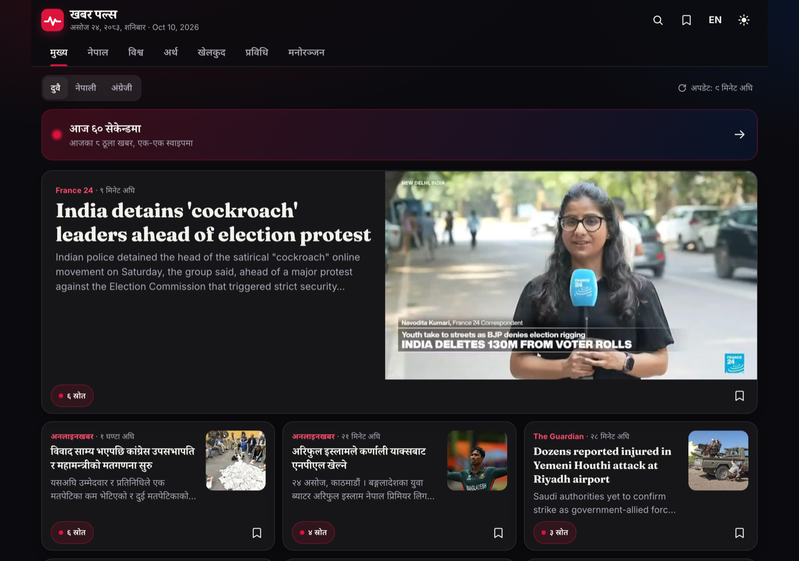
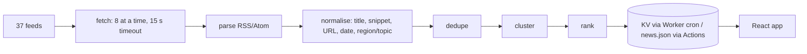

# Khabar Pulse · खबर पल्स

News outlets in Nepal and abroad report the same event under different headlines, in Nepali and English.
Khabar Pulse ingests 37 RSS/Atom feeds from 27 outlets, removes duplicates, and groups reports of the same story
into one card that lists every outlet covering it. The core is a pure TypeScript pipeline with Devanagari-aware headline similarity (token and character n-gram overlap) and a coverage-times-freshness
ranking, shared by a Cloudflare Worker, a GitHub Actions job and the tests.

[](https://github.com/Sabin78910/khabar-pulse/actions/workflows/ci.yml)
[](LICENSE)

**Live:** https://sabin78910.github.io/khabar-pulse/



## Features

- **Story clustering across outlets and scripts.** Headlines are tokenised with Nepali and English stopword lists,
  Nepali digits, danda and zero-width characters normalised, and glued Nepali postpositions (ले, मा, लाई, हरूको ...)
  stripped. Similarity mixes token overlap, character 3-gram overlap and containment, and needs at least two shared words.
- **Ranking by coverage and freshness.** Score grows with the number of distinct outlets (diminishing returns) and
  halves roughly every 6 hours after the newest report. A cluster's topic needs half its reports to agree.
- **Forgiving feed parsing.** A small XML parser handles RSS 2.0, RSS 1.0 (RDF) and Atom, CDATA and the broken
  markup real news sites publish; thumbnails come from media tags, enclosures or the first image.
- **Clean, de-duplicated input.** Canonical URLs without tracking parameters, the same headline from the same outlet
  dropped, RFC 822 and ISO 8601 dates (including +0545), and stable times for undated items across runs.
- **Two serving paths.** A Cloudflare Worker refreshes every 10 minutes into KV and serves a filtered API; without
  it, a scheduled GitHub Actions job publishes `news.json` with the site. Both keep the last good payload when every
  feed fails.
- **App.** Tabs for Top, Nepal, World, Business, Sports, Tech and Entertainment; Nepali/English UI and story-language
  filter; "Today in 60 seconds" briefing of 8 stories with at most 3 per region/topic bucket; search, bookmarks,
  offline cache, Bikram Sambat date and relative times in Nepali numerals. Android build through Capacitor.

## How it works



1. **Fetch** every feed in parallel with bounded concurrency; a failed feed is recorded, never thrown.
2. **Parse and normalise** (`src/pipeline/rss.ts`, `normalize.ts`, `text.ts`): keep up to 40 items per feed from the
   last 36 hours, clean titles, cut snippets to 200 characters at a word boundary, and categorise each article from
   feed tags, URL path and title keywords (`categorize.ts`).
3. **Dedupe** by canonical URL, or by identical headline from the same outlet.
4. **Cluster** (`cluster.ts`): newest first, each article joins the existing group it is most similar to (score of
   at least 0.5, same language, within 36 hours) or starts a new one. An inverted token index limits candidates,
   and very common tokens are skipped as keys to keep comparisons few.
5. **Rank** (`rank.ts`): score each cluster, pick a lead report (image and snippet first), keep the top 300.
6. **Serve:** the Worker answers `GET /api/news?cat=&lang=&q=` (edge-cached for 2 minutes) and `GET /api/health`.
   The app uses `VITE_API_URL` when set, otherwise the static `./news.json`.

## Tech stack

TypeScript · React 19 · Vite · Cloudflare Workers + KV · GitHub Actions and Pages · Capacitor 8 (Android) ·
Vitest + Testing Library · ESLint · CodeQL

## Getting started

Prerequisites: Node.js 22.18 or newer (the news script runs TypeScript directly; CI uses Node 24).

```bash
npm ci
npm run news        # fetch live feeds into public/news.json
npm run dev         # dev server
npm test            # Vitest
npm run lint        # ESLint
npm run typecheck   # app and worker
npm run build       # typecheck + production build
npm run cap:sync    # build and sync into the Android project
```

The Worker is optional. To enable it, add the `CLOUDFLARE_API_TOKEN` and `CLOUDFLARE_ACCOUNT_ID` repository secrets
and run the **Deploy Worker API** workflow, which creates the KV namespace, deploys, seeds KV and rebuilds the site.

## Project structure

```
src/pipeline/   ingestion pipeline: XML/RSS parsing, normalisation, categorisation, clustering, ranking
src/config/     the feed list, with notes on feeds that were checked and left out
src/components/ story card and briefing UI
src/lib/        app logic: API client, Bikram Sambat dates, i18n, bookmarks, streak, briefing selection
scripts/        build-news.ts, the Node entry point used by the GitHub Actions fallback
worker/         Cloudflare Worker: cron refresh into KV and the news API
android/        Capacitor Android project
store/          Play listing text
docs/           screenshots and interaction notes
```

## Testing and CI

- **Pipeline tests** cover the XML parser against RSS 2.0 and Atom fixtures, normalisation, categorisation,
  English and Devanagari tokenisation, paraphrased and postposition-only headline matches, the two-shared-word rule,
  no merging across languages or days, ranking, lead selection, outlet counting and stable cluster ids.
- **App and worker tests** cover Bikram Sambat conversion, relative times, streak, bookmarks, briefing, the news
  client, the API's routing, CORS and cache headers, and keeping the previous payload when every feed fails.
- **Workflows:** `ci.yml` (lint, typecheck, tests, build, `npm audit` for high-severity issues), `codeql.yml`,
  `deploy.yml` (tests, fetch news, build, publish to Pages every 30 minutes and on push to `main`), `worker.yml` (optional
  Worker deploy) and `android.yml` (release App Bundle, signed when the keystore secrets exist).

## Design decisions and limitations

- **Lexical similarity, not embeddings.** Token and character-shingle overlap is cheap, explainable and runs inside a
  Worker's CPU limit, but it cannot match the same story told with different words, and Nepali and English reports of
  one event are deliberately never merged.
- **Greedy single-pass clustering.** Order-dependent by design (newest first) so it stays fast; a later report can join
  a story but two existing clusters are never merged afterwards.
- **Feeds are fragile.** Several outlets had no working feed when the list was checked and are not included;
  any feed can break, and the payload lists failed sources.
- **Free-tier limits.** The Workers free plan caps CPU time per run; if the cron hits it, the GitHub Actions
  `news.json` still updates. GitHub cron can also run late.
- **Publisher-first by design.** The app shows only the headline, a snippet of at most 200 characters, the thumbnail
  and the outlet name with time. Every story credits its source, and every tap opens the publisher's own article.

## License

MIT, see [LICENSE](LICENSE). Privacy policy: https://sabin78910.github.io/privacy-policy/

## Author

Sabin Khanal · [Portfolio](https://sabinkhanal13.com.np) · [LinkedIn](https://www.linkedin.com/in/sabin-khanal-950163326) · [GitHub](https://github.com/Sabin78910)
